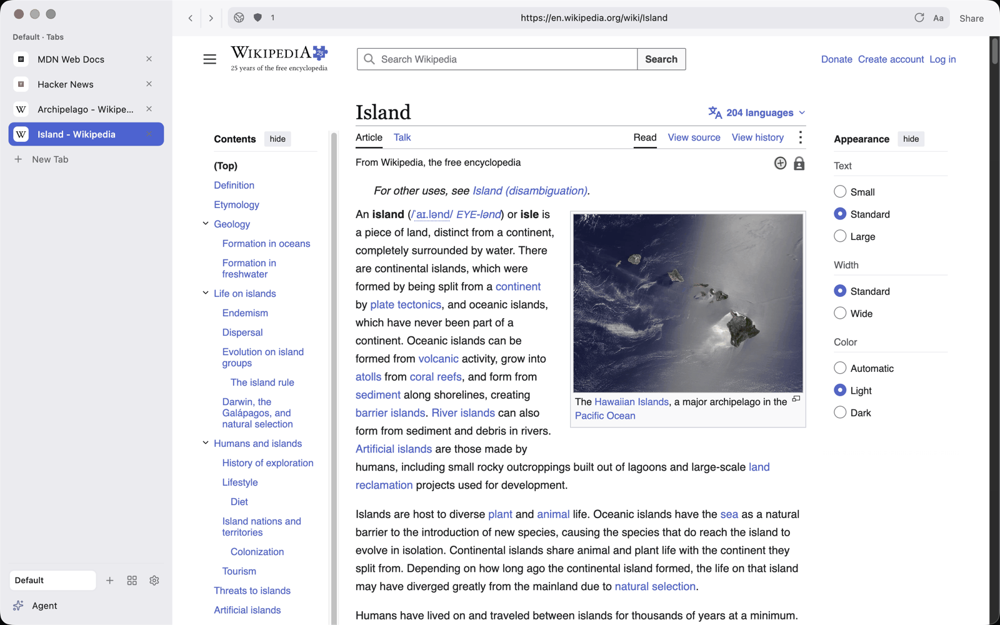
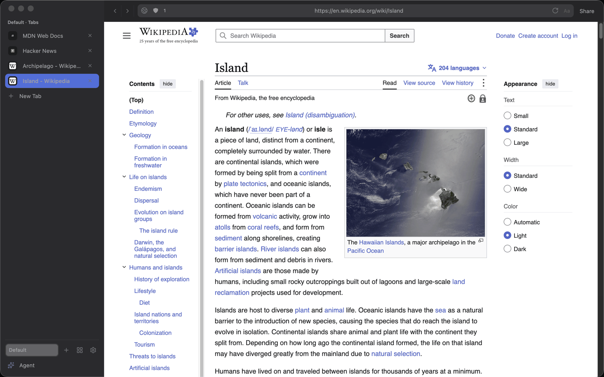
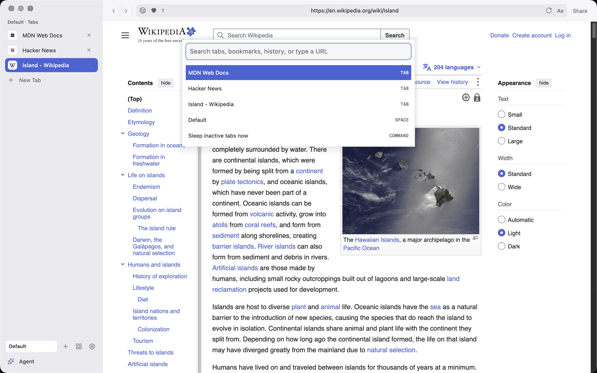
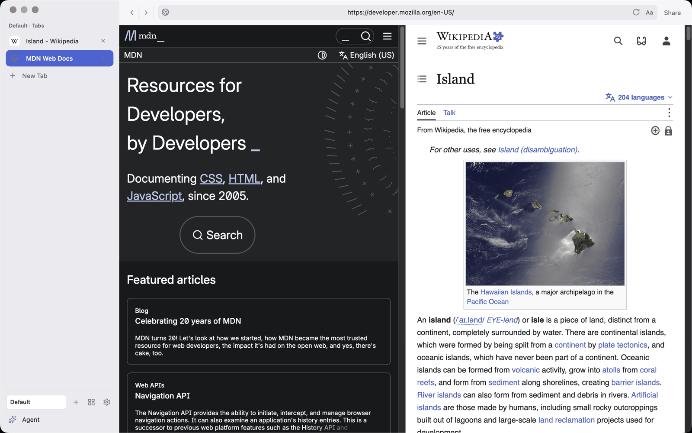
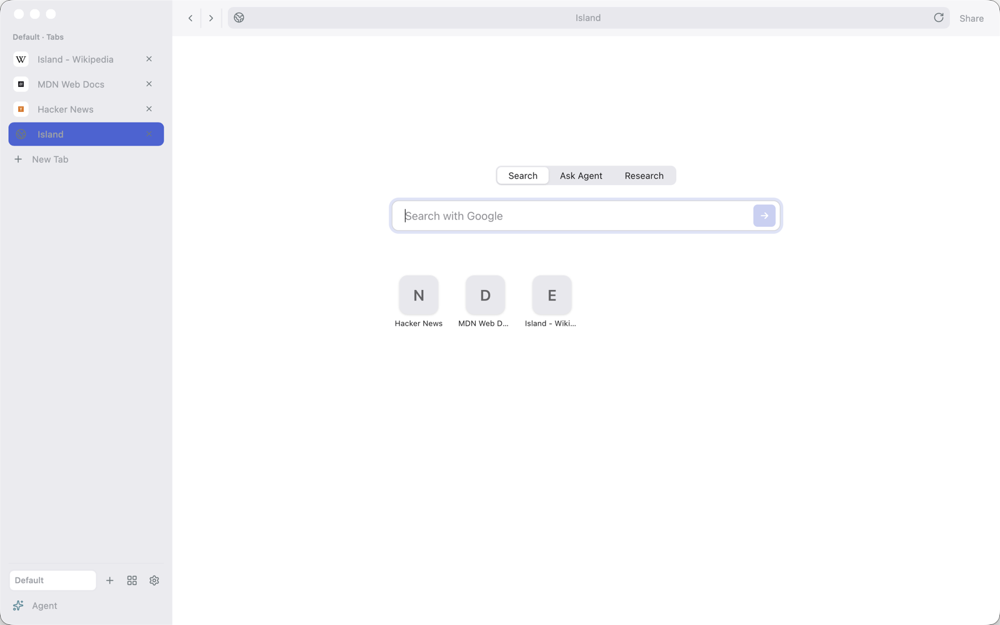
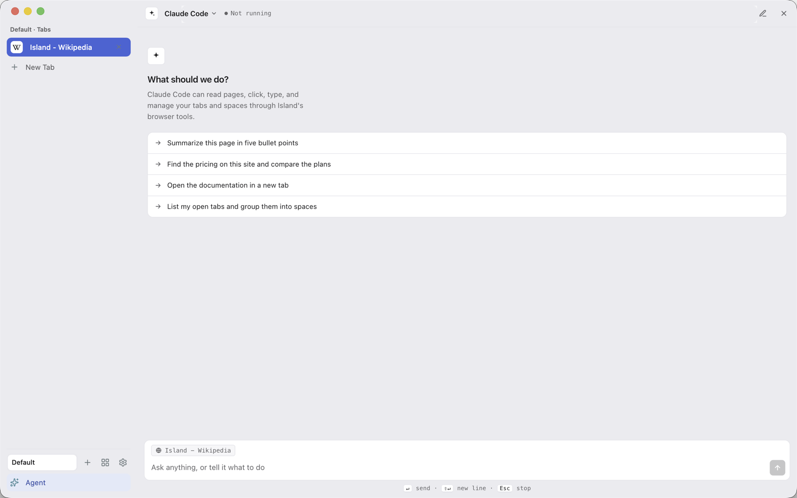
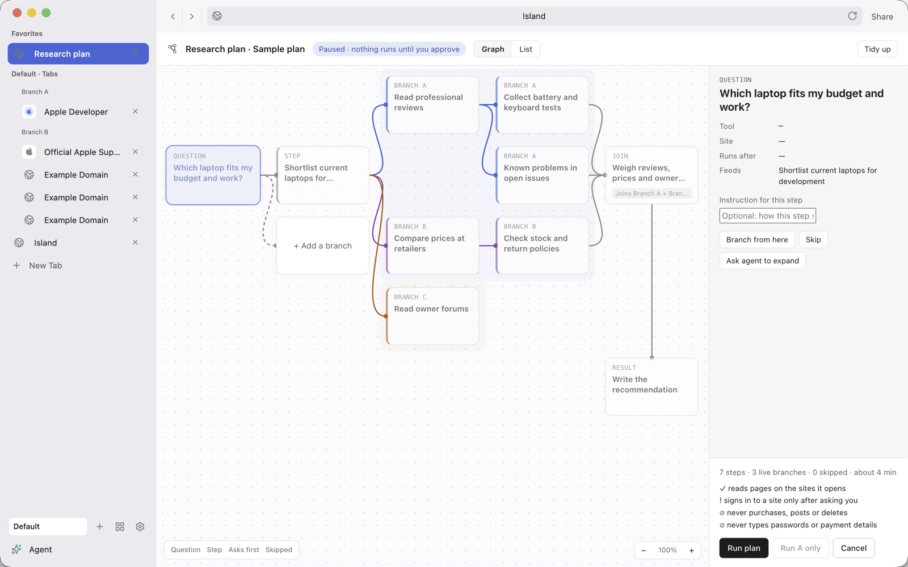
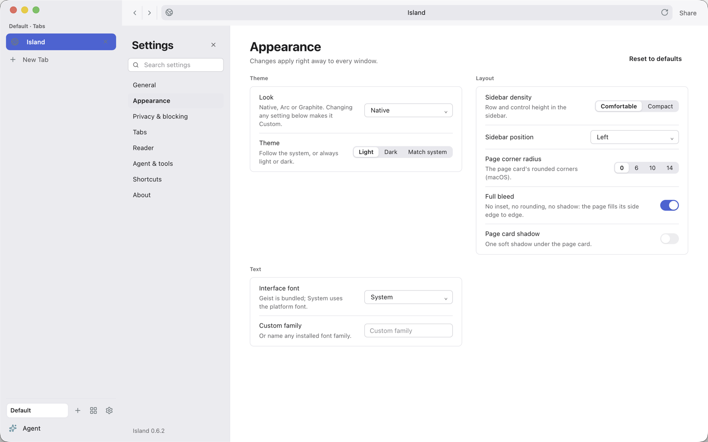
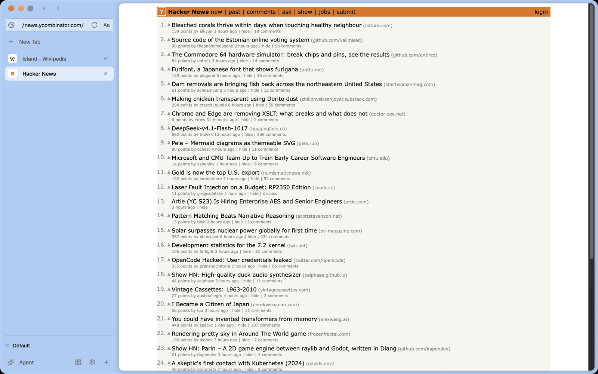

<h1 align="center">Island</h1>

<p align="center"><strong>A fast, native web browser with an AI agent that works on your pages, and asks before it does anything that matters.</strong></p>

<p align="center">
  <a href="https://github.com/island-browser/island/releases">Download</a> ·
  <a href="docs/user-guide/README.md">User guide</a> ·
  <a href="CHANGELOG.md">Changelog</a> ·
  <a href="#keyboard-shortcuts">Shortcuts</a>
</p>

<p align="center">
  
</p>

> **Status:** pre-1.0. Every build is an **unsigned GitHub prerelease**. Only macOS Apple Silicon
> (arm64) has been built, run and packaged by hand. See [Status and platforms](#status-and-platforms).

## Why Island

**It is a native browser, not a web page in a wrapper.** Island is C++20 on the Chromium Embedded
Framework and its native `cef_views` toolkit. The sidebar, tabs, palettes and overlays are native
views, not an Electron app and not a web-based shell, so it opens fast and sits in the system like
any other Mac app.

**The agent works with your pages.** Run Claude Code, Codex, OpenCode, Gemini CLI, Qwen Code, Goose
or your own Agent Client Protocol command in a panel next to your tabs. It can read the page you
are on, open and switch tabs, navigate, click and type through Island's browser tools. Island does
not bundle a model: it starts the agent program you already use.

**Research you can steer.** Ask a question in Research mode and the agent first proposes a plan.
You see it as a graph in a pinned Plan tab. You edit it, skip branches, add your own, and nothing
runs until you press **Run plan**. The plan states its limits up front: it signs in to a site only
after asking you, and it never purchases, posts or deletes. The agent cannot approve its own plan.

**Privacy is built in.** Ads and trackers are blocked natively, before subresources load, on
Brave's open-source `adblock` engine with EasyList and EasyPrivacy. History search runs on your
computer and your history never leaves it. Bookmark import is local too.

**A calm, Mac-native look.** The default Native look is a macOS-style source list, the system font
and one blue accent. Prefer something else? Arc and Graphite looks are one setting away, in light
or dark.

## Take the tour

### Spaces and a sidebar that stays out of the way
Group tabs into spaces (work, travel, research), pin what you need, and reorder from the sidebar
or the menu. `⌘B` collapses the sidebar into a narrow rail of favicons. `⇧⌘A` shows every space's
tabs as searchable cards. The sidebar can sit on the left or the right.



### `⌘K`: one palette for everything
Find open tabs, spaces, bookmarks, on-device history, research reports and commands from one
field, or type a URL. `⇧⌘K` sends a query to Google, ChatGPT, Perplexity, Claude or Gemini.



### Split view
`⇧⌘S` pairs the active tab with the next one, side by side. On macOS the divider moves with
`⌥⌘[` and `⌥⌘]` (and the menu), not by dragging.



### A start page with three modes
Every new tab opens on **Search**, **Ask Agent** or **Research**. Under the field, six
speed-dial tiles come from the sites you visit most. They come from your on-device history, and
clearing history clears them.



### The agent panel
`⌘J` opens the agent. It shares the current tab as context (you can turn that off), renders
Markdown replies and offers prompts to start from. Pick the agent in the panel header; the menu
shows which ones are installed.



### Research and the Plan tab
In Research mode the plan is a graph you can read before anything happens: a question, steps,
branches (up to three levels), joins and a result. Click a step to give it an instruction, branch
from it, skip it or ask the agent to expand it. When it runs, the pages the agent opens become
grouped child tabs in the sidebar, and the answer lands in a Report tab you can save, copy or
continue in the agent panel.



*(The screenshot shows Island's built-in sample plan, with its grouped child tabs.)*

### Privacy
- **Ad and tracker blocking** with separate controls for ads and trackers, a shield with a count in
  the address field, and a per-site allowlist.
- **On-device history search** through the command palette. History can be turned off or cleared.

### Reading and pages
- **Reader view** (`⌥⌘R`) and **find in page** (`⌘F`).
- **Tab sleep** releases the browser of tabs you have not used (30 minutes by default; set 15, 30,
  60 or Never in Settings > Tabs). Sleeping tabs keep their title and place.
- **Peek** opens a link in a floating card: `⌘`-click, middle-click or the context menu.

### Looks and settings
Settings (`⌘,`) has General, Appearance, Privacy & blocking, Tabs, Reader, Agent & tools, Shortcuts
and About, with search. Appearance holds the look preset and theme, sidebar density and position,
corner radius, font and more. Every shortcut can be rebound.



For contrast, here is the **Arc** look: a space-tinted canvas with a rounded page card.



## Try it in 2 minutes

1. **Download.** Open [GitHub Releases](https://github.com/island-browser/island/releases) and take
   `island_browser-<version>-macosarm64.dmg` (or the `.zip`) for an Apple Silicon Mac. Other
   targets: `island_browser-<version>-macosx64.*`, `-windows64-setup.exe` / `-windows64.zip`,
   `-windowsarm64-*`, `-linux64.deb` / `-linux64.tar.gz`, `-linuxarm64-*`. Each release has a
   `SHA256SUMS.txt`. `nightly` is a rolling prerelease of `main`; `vX.Y.Z` is one per version.
2. **Open it.** Builds are not signed or notarized, so Gatekeeper refuses at first. Drag Island to
   Applications, then either allow it in System Settings > Privacy & Security or run
   `xattr -dr com.apple.quarantine /Applications/Island.app`.
3. **First launch.** A Welcome card asks for a theme and offers to import bookmarks from
   Chrome-family browsers, Safari, Firefox and Arc. Skip it with **Start browsing**.

Then try five things:

| Try this | Keys |
|----------|------|
| Jump anywhere: tabs, history, commands, or type a URL | `⌘K` |
| Open two pages side by side | `⇧⌘S` |
| Ask the agent about the page you are on | `⌘J` |
| Run a Research from the start page and review its plan | `⌘T`, then **Research** |
| Read without distractions, then find a word | `⌥⌘R`, `⌘F` |

(On Windows and Linux, use `Ctrl` for `⌘` and `Alt` for `⌥`.)

## Examples

**Ask about a page.** Open an article, press `⌘J`, and pick *Summarize this page in five bullet
points* or type your own request. The current tab is shared as context.

**Run a research.**
1. Open a new tab and choose **Research**.
2. Type a question, for example *Which laptop fits my budget and work?*.
3. Island opens the **Plan** tab. Read the graph, skip a branch, add one, or select a step and
   write an instruction for it.
4. Press **Run plan** (or **Run A only** to run one branch). Watch child tabs open, grouped by
   branch.
5. Read the answer in the Report tab; save or copy it, or continue in the agent panel.

**Use Island from Claude Code or another MCP client.** Island serves its browser tools at
`http://127.0.0.1:<port>/mcp` on your machine, protected by a bearer token that changes on every
launch. **Settings > Agent & tools > MCP endpoint** shows the live config with a Copy button. It
looks like this:

```json
{
  "mcpServers": {
    "island": {
      "type": "http",
      "url": "http://127.0.0.1:<port>/mcp",
      "headers": {
        "Authorization": "Bearer <token>"
      }
    }
  }
}
```

Island also writes a discovery file, `agent-endpoint.json`, with the `url`, `token`, `transport`
(`streamable-http`) and `pid`. It lives next to your preferences:

| OS | Path |
|----|------|
| macOS | `~/Library/Application Support/Island/agent-endpoint.json` |
| Linux | `$XDG_DATA_HOME/Island/` or `~/.local/share/Island/agent-endpoint.json` |
| Windows | `%APPDATA%\Island\agent-endpoint.json` (no `pid` field) |

For clients that only launch stdio MCP servers, use the bridge that ships next to the browser
binary (`island_mcp_bridge`, in `Island.app/Contents/MacOS/` on macOS). It finds the endpoint from
`ISLAND_MCP_URL` and `ISLAND_MCP_TOKEN`, then from `--endpoint-file <path>`, then from the
discovery file. Island must be running. Island's own agent panel and an external agent use the same
tools, and neither can approve or edit the Plan tab.

## Keyboard shortcuts

Shortcuts are for macOS; on Windows and Linux use `Ctrl` for `⌘` and `Alt` for `⌥`. Every shortcut
can be changed in Settings > Shortcuts, and `⌘/` shows a cheatsheet.

| Action | Keys |
|--------|------|
| Command palette | `⌘K` |
| Search palette (Google, ChatGPT, Perplexity, Claude, Gemini) | `⇧⌘K` |
| Show or hide the agent | `⌘J` |
| New tab / Close tab / Reopen closed tab | `⌘T` / `⌘W` / `⇧⌘T` |
| Next / previous tab | `⇧⌘]` / `⇧⌘[` |
| Select tab 1 to 8 / the last tab | `⌘1`–`⌘8` / `⌘9` |
| Focus the address field | `⌘L` |
| Back / Forward / Reload | `⌘[` / `⌘]` / `⌘R` |
| Toggle sidebar | `⌘B` |
| All tabs | `⇧⌘A` |
| Pin or unpin tab | `⌘D` |
| New space / Rename space | `⌥⌘N` / `F2` |
| Next / previous space | `⌥⌘↓` / `⌥⌘↑` |
| Split view with the next tab | `⇧⌘S` |
| Move split divider left / right | `⌥⌘[` / `⌥⌘]` |
| Find in page / next / previous | `⌘F` / `⌘G` / `⇧⌘G` |
| Reader mode | `⌥⌘R` |
| Zoom in / out / reset | `⌘=` / `⌘-` / `⌘0` |
| Copy tab URL | `⇧⌘C` |
| Settings | `⌘,` |
| Shortcut cheatsheet | `⌘/` |

The full list, with Windows and Linux keys, is in
[docs/user-guide/reference/keyboard-shortcuts.md](docs/user-guide/reference/keyboard-shortcuts.md).

## Status and platforms

- **Unsigned prereleases only.** Stable public release is blocked until signing and notarization
  verification exist.
- **Platforms.** The intended targets are `macosarm64`, `macosx64`, `windows64`, `windowsarm64`,
  `linux64` and `linuxarm64`. Only macOS arm64 is built, tested and run by hand. The other five
  need native GitHub Actions evidence before they count as supported; see
  [docs/supported-platforms.md](docs/supported-platforms.md).
- **Not in scope:** browser extensions (they need CEF's Chrome runtime; Island uses Alloy), sync,
  profiles and accounts, and more than one top-level window.
- **Updates.** The built-in updater checks GitHub releases, verifies the SHA-256 checksum and swaps
  the app in on "Restart to update".
- **Visual acceptance** (Phase 3 U10) still needs a human with display access.

## Build from source

Requirements: CMake, a C++20 compiler, Python 3, network access for the first configure
(GoogleTest), and a stable Rust toolchain for the ad blocker (without `cargo`, a no-op blocker is
built).

```bash
bash -n scripts/setup_deps.sh
./scripts/setup_deps.sh --dry-run
./scripts/setup_deps.sh
python3 scripts/deps.py verify
cmake -B build -S .
cmake --build build
ctest --test-dir build --output-on-failure
open build/src/main/island_browser.app
```

`scripts/setup_deps.sh` vendors the pinned CEF distribution into `third_party/cef/` and the Geist
fonts into `assets/fonts/`; both stay out of git. Smoke run on macOS:

```bash
open build/src/main/island_browser.app --args --island-smoke-test
pgrep -fl island_browser || true   # after quitting: no helper processes should remain
```

The AI-agent kernel and the search kernel also build standalone, without CEF:

```bash
cmake -B build-agent -S src/agent && cmake --build build-agent
ctest --test-dir build-agent --output-on-failure
python3 -m pytest tests/deps tests/package tests/design tests/version
```

Build-time detail: [AGENTS.md](AGENTS.md), [docs/release-process.md](docs/release-process.md).

## Project layout

| Path | Contents |
|------|----------|
| `src/main/` | The browser: CEF app and window, native chrome, tabs, spaces, local pages (`pages/`) |
| `src/agent/` | CEF-free agent kernel: MCP tools endpoint and ACP client |
| `src/search/` | CEF-free search kernel behind on-device history search |
| `src/content_blocker_ffi/` | Rust crate wrapping Brave's `adblock` engine |
| `tests/`, `bench/` | GoogleTest and pytest suites; benchmark support |
| `scripts/`, `deps/`, `cmake/` | Dependency vendoring, packaging, versioning, platform CMake |
| `docs/` | Process docs, specs and plans, and the [user guide](docs/user-guide/README.md) |
| `DESIGN.md` | The product and visual design narrative |

## Documentation

- [User guide](docs/user-guide/README.md): task-first help, written to be published on GitBook.
- [CHANGELOG.md](CHANGELOG.md): every release and the unreleased notes.
- [DESIGN.md](DESIGN.md): why Island looks and behaves the way it does.
- [docs/supported-platforms.md](docs/supported-platforms.md) and
  [docs/release-process.md](docs/release-process.md).

## Contributing

- Read [AGENTS.md](AGENTS.md) first. Only units of an accepted spec and plan are implemented.
- Work on a branch and open a pull request. Build and test locally before committing; GitHub
  Actions triggers are mostly paused.
- Add your change to `## [Unreleased]` in `CHANGELOG.md`. Do not edit `VERSION` by hand: the
  project owner bumps it with `python3 scripts/version.py bump <part>` and merges the PR. Run
  `python3 scripts/version.py check` before committing version changes.
- Style: Google-based, 4-space indent, 100 columns, explicit `std::`, target-scoped CMake.

Licensed under the terms in [LICENSE](LICENSE).
